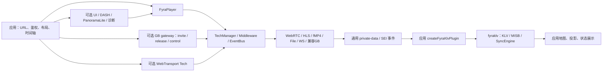

# 当前架构与所有权

FyraPlayer 是播放 SDK。主类协调生命周期、Source、Tech、事件和中间件；播放实现位于 Tech；UI、DASH、诊断、鉴权、录制 API、元数据解析桥接及 PanoramaLite 通过插件启用。

## 模块边界

| 所有者 | 职责与限制 |
| --- | --- |
| `src/player.ts`、`src/core/` | 加载队列、切源、销毁、重连、Tech 选择、事件和中间件 |
| `src/techs/` | 协议播放、原生/MSE/实验 WebCodecs 路径及底层通用元数据提取 |
| `src/plugins/` | 显式启用的产品能力，包括无 UI 截图与显示帧时钟；录制插件调用后端 API，GB28181 也需要后端网关 |
| playback-health 观察插件 | 复用 frame-clock/会话事件，按实例统计首帧与无进展区间；排除暂停/后台/seek，不调用重连或调度其他 Player |
| GB gateway adapter | 应用注入开流/控制/释放回调；resolve 得到标准 Source，所选媒体 Tech 负责播放，旧 gb28181 Tech 保留兼容 |
| WebTransport Tech 插件 | 可选 HTTP/3 可靠单向流 + WebCodecs；单一 fyra-media 格式，视频与可选通用 raw metadata，共同原始微秒时钟；首帧期限、队列上限；无音频且实验性质 |
| `src/render/` | 通用视频/帧与 canvas 输出 |
| PanoramaLite 插件 | 包内可选的等距柱状全景渲染；不是 PSV/Cesium 适配器 |
| fyraklv 独立包 | KLV/MISB 解析、PTS 缓冲和插值、异常过滤、离线/服务端 TS 提取 |
| 应用层集成 | 显式对齐视频时间与流 PTS；决定解析服务、地图和渲染器生命周期；多路协调器持有多个 Player 并管理预算/焦点 |

[多路监看示例](multiview.md) 提供应用层协调器，持有资源 lease 并限制活动/启动实例数；资源实际释放后才归还名额，核心和单实例插件不引入全局调度。示例关闭 Player 自动重连，失败等待用户重试，防止绕过集中启动预算。

播放器与 fyraklv 无相互运行时依赖。`MetadataBridge` 只调用注入的解析函数；旧名 `KlvBridge` 是兼容别名。应用示例 [createFyraKlvPlugin](../examples/integrations/fyraklv.ts) 接受结构化服务，`KLVStreamManager` 满足该契约。该示例没有作为 SDK 子路径发布。

两套 TS demux 继续保留：播放器服务于播放和通用 metadata；fyraklv 服务于独立元数据消费。通过播放器事件接入时不再次 demux 同一 TS。

WebTransport 不增加 KLV 解析依赖。[应用组合示例](../examples/integrations/webtransport-klv.ts) 将同流原始帧/metadata 微秒时钟换为一致的 90kHz 查询刻度，配置 discontinuity 由核心 epoch 清空缓冲；该 clock 是 canvas 绘制时间，仍需应用验证屏幕呈现与外部遥测误差。

## 生命周期与回退

- 并发初始化共享在途加载；切源创建新加载代次。队列串行操作同一 Tech，尚未执行的旧切源被跳过。
- 旧代次的事件、异步完成和控制操作不能更新新源状态或重启定时器。`sourcechange` 在切源请求进入队列后同步发出，表示请求变更，不表示加载成功。
- `destroy()` 立即使旧代次失效，解绑事件并停止定时器，同时 abort 插件 scope；等待在途加载后最终销毁 Tech 和插件。重复调用返回同一 Promise，销毁后必须创建新实例。
- 加载中间件与 TechLoadOptions 现有可选 signal，支持配置逐步骤/尝试超时。中间件、DASH/File/WS MSE 模块加载、WebRTC 信令、direct fMP4 与 GB invite/MSE 已接入；尚未迁移的实验解码循环或自定义 Tech.load 仍可能延迟切源/销毁。加载完成后与 Tech 运行期分开清理，见 [会话与取消覆盖](playback-sessions.md)。
- 一个 URL 加载失败不禁用整个 Tech，因此 HLS 主源失败后可以尝试 HLS 备用 URL。显式禁用 Tech 的接口继续保留。
- MSE 初始化不等待直播首帧 play Promise；运行时播放失败通过错误回调报告。stop 使在途 loader 和迟到的播放回调失效，单项清理失败也继续释放其余资源。
- 插件读取 storage 时才访问 localStorage；访问被拒绝时返回 undefined。

## 插件生命周期

工厂是同步 PluginCtor。Player 为每次注册提供独立的 `lifecycle.signal/onCleanup`；类型上可选以兼容自定义宿主。插件按数组顺序安装、逆序销毁，provider 应放在 consumer 前面。先执行返回的 destroy 并保留 this，再逆序执行 scope cleanup；清理函数应幂等。重复 apply 同一注册不会重复初始化。

初始化抛错会 abort scope 并回收已登记资源；未登记的副作用无法自动恢复。单个 destroy/cleanup 失败不阻止其余清理；`PlayerOptions.onPluginError` 报告 setup/destroy/cleanup，默认 console.warn。立即 abort 是协作式取消，插件需要主动响应，不能强制终止任意第三方 Promise。

snapshot、frame-clock、metadata、recording 接入 scope 取消，diagnostics 接入初始化失败回收；旧插件仍可通过返回 destroy 清理。插件 scope 属于实例生命周期，TechLoadOptions.signal 属于一次加载尝试，二者不同。没有新增运行时插件热装卸、依赖容器或自动依赖排序。

`getPlaybackSession/sessionchange` 现已提供所选 Tech/source 与播放器时间轴 epoch。请求源 API 保持兼容，WS 内部实验→MSE 回退会报告新的会话源。frame-clock、snapshot 和应用 KLV 适配器响应 epoch 变化；尚未检测的协议内部 discontinuity 仍需 Tech 接入，详情见 [播放会话](playback-sessions.md)。

用法见 [监控插件](monitoring-plugins.md)，后续能力和多路分工见 [监控/无人机路线](monitoring-roadmap.md)。

## 发布与兼容

主入口和 `/core` 仍是兼容的广泛导出入口，不能把 `/core` 理解成只包含状态机的最小包。消费方优先使用公开子路径，不导入 `src/` 或内部 dist 文件。源码中只有转导出的兼容入口也属于公共契约。

实验 WebCodecs/WASM 路径仍保留并标注实验性质。WS TS 元数据提取需要 `pipeline: 'experimental'`；默认 MSE 或回退 MSE 不提供同等提取能力。详见 [KLV 接入](klv-integration.md)。

开发示例统一使用 Vite，产物在 site-dist；npm SDK 产物在 dist，两者均不提交。ESM、声明文件、可选 DASH vendor 和 IIFE 一并进入发布验证。
