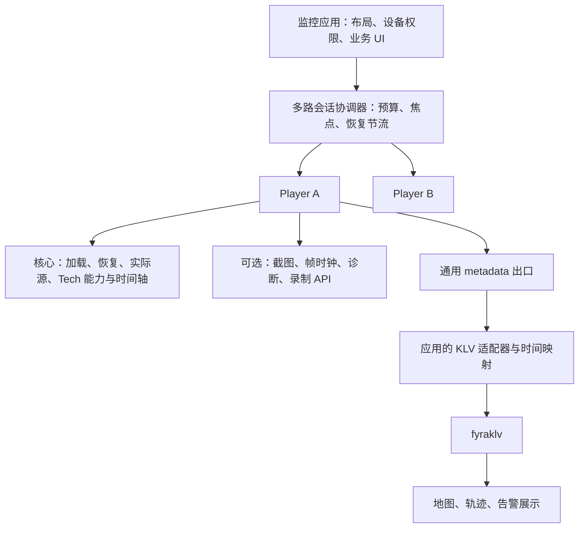

# 监控与无人机能力推进

2026-10-13 的方向选择：多路、低延迟、KLV 同步。当前插件边界总体合理，下一步应优先补足真实播放会话和时间轴契约，再扩展协议相关策略。以下“建议”均不是已实现 API 或生产性能承诺。

## 当前可用基础

| 能力 | 当前状态与边界 |
| --- | --- |
| 播放与容错 | 多种 Tech、串行切源、同 Tech 备用源及重连；新增会话源/epoch 事件和协作取消契约，部分内部路径报告及取消尚待接入，见 [会话契约](playback-sessions.md) |
| 插件生命周期 | 本轮增加作用域 AbortSignal、初始化失败回收、逆序幂等清理与 onPluginError；旧插件仅返回 destroy 仍兼容 |
| 无 UI 截图 | 本轮提供 snapshot 子路径，返回 Blob；不包含地图/KLV/全景覆盖层 |
| 帧时钟 | 本轮提供 frame-clock 子路径，rVFC 与显式低精度回退；没有自动 PTS 原点、回绕或跨路同步 |
| KLV | 独立 fyraklv 提供解析/缓存/插值；WebTransport 提供同流 raw metadata 与原始 canvas 帧时钟，[组合示例](../examples/integrations/webtransport-klv.ts) 统一查询刻度；默认 WS MSE 没有相同出口 |
| 观测与录制 | 已有 diagnostics、metrics、performance、录制后端 API、鉴权插件；不是完整监控平台 |
| 播放健康观察 | 新增可选 playback-health：首帧、卡顿区间、恢复耗时、证据式错误分类；排除暂停/后台/seek，详见 [API](monitoring-plugins.md) |
| 多路 | 新增 [四路页面与应用层调度器](multiview.md)：实例/启动预算、焦点优先、离屏/后台释放与返回限流；WebTransport 已做本机 320×200 两路 H.264 + 两路 HEVC 同时启动及清理检查，非容量指标；未验证 16/32 路性能 |

## 职责分配

图中的多路协调器已有应用层示例；统一能力查询仍是待推进项。实际所选源/会话 epoch 已提供基础契约，尚需更多 Tech 报告内部变化。多路协调器持有多个 Player，由应用或独立会话包实现；单个 Player 插件只暴露本实例的观察/控制能力，不遍历全局 DOM 或操控其他实例。

KLV 解析保持在 fyraklv。地图、投影、PTZ 权限、设备目录和告警业务由应用/服务端持有。轻量观察、捕获、统计和适配能力作为可选插件合理；网络重连、Tech 选择、加载取消和事件一致性必须由核心统一协调。

## 建议顺序与验收

| 顺序 | 工作 | 所属层 | 验收条件 |
| --- | --- | --- | --- |
| P1.1 | 会话源/epoch 基础已实现；继续补齐协议内部变化和 metadata/显示时钟/seek/live-edge 能力查询 | 核心 + Tech | 切源、同 Tech fallback、WS 实验→MSE、核心重连已通知；进一步验证 HLS discontinuity、WebRTC 内部重协商和设备重启 |
| P1.2 | 协作取消/逐步骤超时已实现，继续迁移实验循环与恢复仲裁 | 核心 + Tech | 中间件、DASH/File/WS MSE loader、WebRTC 信令、direct fMP4、GB invite/MSE 已覆盖；实验解码循环仍需响应 signal；鉴权恢复与网络重连不互相竞争 |
| P1.3 | playback-health 基础已实现；继续实际设备/弱网验收 | 观测插件 + 核心事件 | 排除暂停、seek、后台和已知应用挂起；标注精度及未知错误原因，实际帧推进判定恢复；尚不能仅凭无帧区分网络/解码根因，不报告伪端到端延迟 |
| P1.4 | 实例/启动预算、焦点/可见性调度与恢复限流已有四路示例；继续主/子码流与容量实测 | 应用会话协调器 | 在目标硬件上跑 1/4/9/16/32 路，记录 codec/分辨率/帧率/浏览器/网络；测首帧 p95、恢复 p95、CPU/GPU/内存、丢帧和后台恢复；预算以实测设定 |
| P1.5 | KLV 连续时间轴与同步证据 | 应用传输适配 + fyraklv | WebTransport 同流微秒、精确整数换算及配置重置已接入；TS 33 位回绕、内部重启和真实屏幕/遥测同步误差仍需验证，不能只依据换算和查询一致性 |
| P2.1 | Live edge / DVR 插件与可配置追帧策略 | 能力契约之上的可选插件 | 先提供每个 Tech 的 seekable/live-edge 能力；对暂停回看、缓冲耗尽、追帧上限验证；不和 hls.js/DASH 内部 ABR/latency controller 叠加竞速 |
| P2.2 | 标注/ROI、告警关联、证据截图组合 | 应用渲染适配器 + 截图插件 | 明确视频坐标→展示坐标映射、采样时钟与告警 ID；应用决定持久化、上传和叠加内容 |
| P2.3 | PTZ 控制适配与回执 | 网关服务 + 可选 UI/适配插件 | 复用现有 gb:ptz 入口；处理停止指令、节流、权限和设备回执，后端负责 SIP/ONVIF/厂商协议 |
| P2.4 | 时间片段导出/帧步进 | 后端索引 + Tech 能力 | 导出依赖录像索引和服务端裁剪；精确帧步进依赖解码帧/关键帧能力，不把 currentTime += 1/fps 称为精确逐帧 |
| P3 | 字幕、DRM、广告、WebXR | 独立可选插件 | 按后续产品需求推进，当前不占用监控主线资源 |

启动/冻结观测基础已提供，后续优先推进多路实测、基于明确能力契约的 live-edge/DVR 和业务可选的标注/告警桥接。多路同步还需要摄像机/服务端共同时间基准，浏览器帧时钟本身不能完成不同摄像机的校时。

## 质量与工程约束

现有 Jest、真实 tarball、类型、导出与浏览器 smoke 证明相应路径可用，不证明多路上限、弱网恢复或 KLV 端到端同步已达标。真实 TS 的 metadata 提取和视频呈现路径要同时成立，默认/回退 MSE 与实验 canvas 的边界见 [KLV 接入](klv-integration.md)。

保留有效回归、实验管线和真实媒体 fixture。新插件走独立公开子路径并检查依赖，不通过堆积插件数量衡量成熟度。根入口与 /core 的物理拆分、协议长跑和设备矩阵仍是独立工程事项。实现说明见 [监控插件 API](monitoring-plugins.md)，验证结果见 [复盘](review-2026-10.md)。
